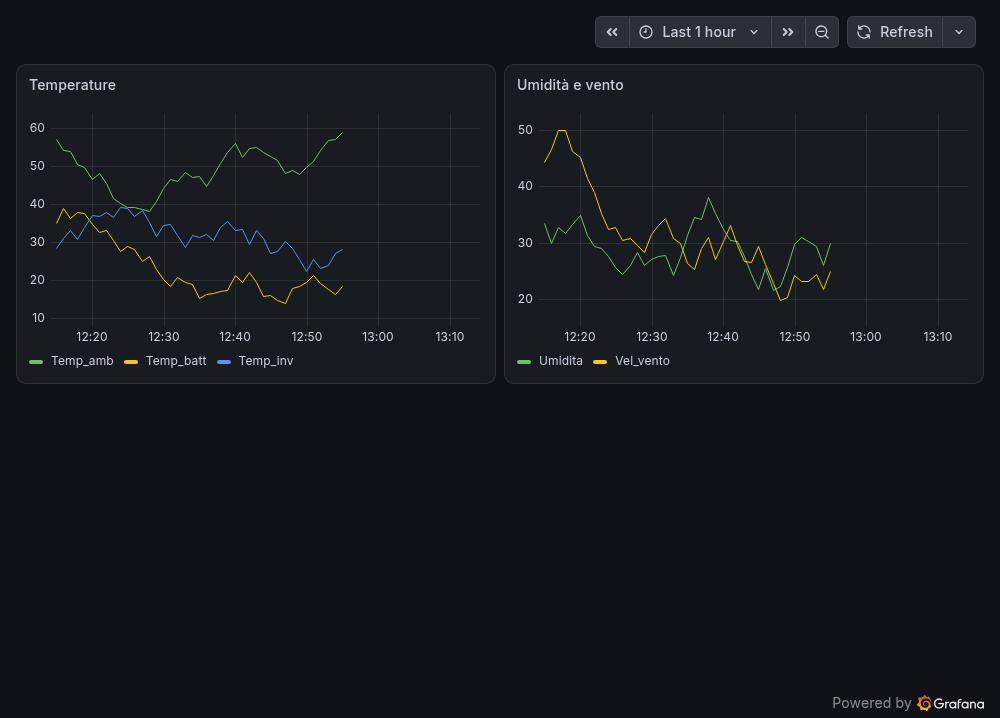

# Progetto_tesi — Energy monitoring dashboard (C# + Modbus RTU + InfluxDB + Grafana)

Windows desktop application developed for my thesis project. It acquires data from a real
energy meter over **Modbus RTU**, stores it locally as CSV, uploads it to **InfluxDB Cloud** and
visualises it on a **Grafana** dashboard.



*Example dashboard built on simulated data (50 points, one per minute).*

## Features

| Mode | What it does |
|------|--------------|
| **Real plant (Modbus RTU)** | Connects to an energy meter over a serial port, reads **current** and **power** every ~60 s, saves them to `Val_impianto.csv` and uploads them to InfluxDB automatically. |
| **Simulated data** | Generates random values (battery / inverter / ambient temperature, humidity, wind speed), shows them in the UI, saves them to `random_values.csv` and uploads them to InfluxDB. The `Genera 50 punti di prova` button creates 50 simulated points (one per minute) so the dashboard has something to plot. Useful to test the whole pipeline without hardware. |

> **Note on testing:** the Modbus acquisition was developed and tested on real hardware during
> the thesis work (September 2024). The simulated mode and the demo points are **simulated data** and are
> only meant for demonstrating the pipeline without the energy meter.

## Data flow

```
Energy meter ──Modbus RTU──► C# WinForms app ──► CSV file ──► Python script ──► InfluxDB Cloud ──► Grafana
 (COM port)                  (EasyModbus)                     (influxdb-client)
```

Technical notes:
- Modbus values are returned as two 16-bit registers and converted to IEEE754 32-bit floats
  (`IEEE754_converter` in `Form1.cs`).
- The C# app launches `Cart_Per_P/Caric_Influx.py`, passing the CSV path as argument.
- All points are written to the measurement `senso_dati`, one field per CSV column.
- InfluxDB identifies a point by measurement + tags + timestamp, so re-uploading a point with the
  **same timestamp** overwrites it instead of duplicating it.

## Requirements

- Windows, Visual Studio 2019/2022 with the **.NET desktop development** workload (.NET Framework 4.7.2)
- Python 3.8+ with `pip install -r Cart_Per_P/requirements.txt`
- An InfluxDB Cloud account (bucket + API token with write permission)
- A Grafana account (Grafana Cloud free tier is enough)
- For the real plant mode: a Modbus RTU device on a serial port (default `COM4`, 9600 baud, 8N1, unit ID 5)

## Setup

1. Clone the repository and open `Progetto_tesi.sln` (NuGet restores `EasyModbusTCP` automatically).
2. Set the InfluxDB credentials as environment variables (never commit the token):
   ```bat
   setx INFLUX_TOKEN "your-token"
   setx INFLUX_ORG "your-org"
   setx INFLUX_BUCKET "your-bucket"
   setx INFLUX_URL "https://<your-region>.aws.cloud2.influxdata.com"
   ```
   Restart Visual Studio afterwards so it picks up the variables.
3. Adjust the constants at the top of `Form1.cs` if your serial port, unit ID or baud rate differ.
4. Build and run (F5). Generated CSV files appear next to the executable (`bin/Debug`).

## Usage

- **Real plant mode:** `Collegamento Modbus RTU` → `Avvia acquisizione automatica` to start
  periodic acquisition, `Ferma acquisizione` to stop it.
- **Simulated mode:** `Genera valori casuali` → `Salva su CSV` → `Carica su InfluxDB`
  (`Cancella CSV` removes the local file). Alternatively use `Genera 50 punti di prova` followed by
  `Carica su InfluxDB` to get a ready-made series for the dashboard.

> The CSV files are **appended to**, never overwritten. `Genera 50 punti di prova` adds 50 new points ending
> at the current time, so pressing it twice produces two overlapping series (the chart then shows vertical
> jumps). To start a clean demo, press `Cancella CSV` first, then generate the points once.
> `Cancella CSV` only deletes the local file: points already uploaded stay in the InfluxDB bucket
> (use a new bucket or delete the old data there).

## Grafana dashboard

1. In Grafana add a **InfluxDB** data source: query language **Flux**, your InfluxDB URL, organization,
   API token and default bucket.
2. Import the ready-made dashboard: **Dashboards → New → Import** and upload
   [`grafana/dashboard.json`](grafana/dashboard.json). The file references the data source of the
   original instance, so after importing open each panel and select your own InfluxDB data source.
   The queries use the bucket name `progetto_bucket`: change it to yours.
3. Set the time range to cover the uploaded data (for the demo points: *Last 1 hour*).

Or create the panels by hand with these Flux queries (replace `your-bucket`):

**Temperatures**
```flux
from(bucket: "your-bucket")
  |> range(start: v.timeRangeStart, stop: v.timeRangeStop)
  |> filter(fn: (r) => r._measurement == "senso_dati")
  |> filter(fn: (r) => r._field == "Temp_batt" or r._field == "Temp_inv" or r._field == "Temp_amb")
```

**Humidity and wind speed**
```flux
from(bucket: "your-bucket")
  |> range(start: v.timeRangeStart, stop: v.timeRangeStop)
  |> filter(fn: (r) => r._measurement == "senso_dati")
  |> filter(fn: (r) => r._field == "Umidita" or r._field == "Vel_vento")
```

**Current and power (real plant mode)**
```flux
from(bucket: "your-bucket")
  |> range(start: v.timeRangeStart, stop: v.timeRangeStop)
  |> filter(fn: (r) => r._measurement == "senso_dati")
  |> filter(fn: (r) => r._field == "current" or r._field == "power")
```

## Project structure

```
Form1.cs / Form1.Designer.cs   UI and application logic
Program.cs                     Entry point
Cart_Per_P/Caric_Influx.py     CSV → InfluxDB uploader
grafana/dashboard.json         Exported Grafana dashboard
docs/dashboard.png             Dashboard screenshot
```

## Tech stack

C# · .NET Framework 4.7.2 · Windows Forms · EasyModbus · Modbus RTU · Python · InfluxDB · Grafana
